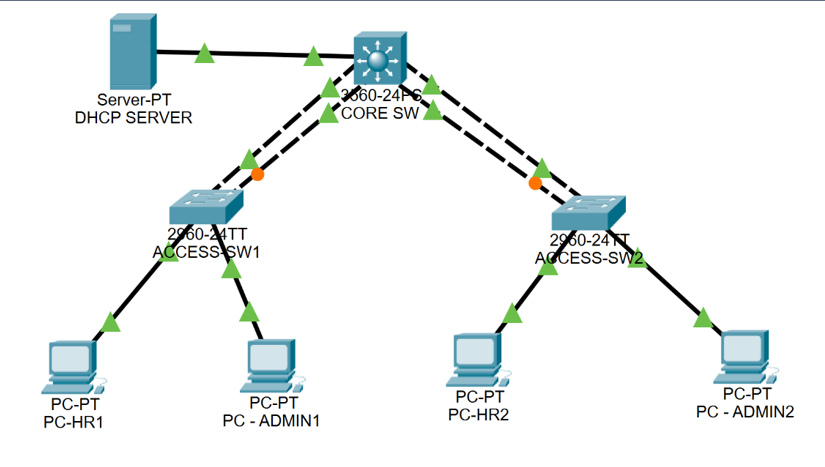

# Campus LAN Switching and Services Lab

Cisco Packet Tracer portfolio project by Affissou Gbadamassi. The campus topology connects a multilayer core switch, two access switches, four HR and Admin PCs, and a centralized DHCP server.

## Labs

| Lab | Verification shown |
| --- | --- |
| [VLANs and 802.1Q Trunking](labs/01-vlan/README.md) | VLAN creation and access-port membership |
| [LACP EtherChannel](labs/02-etherchannel/README.md) | Bundled LACP links and operational 802.1Q trunks |
| [Inter-VLAN Routing](labs/03-inter-vlan-routing/README.md) | Connected routes and reachability across VLANs |
| [Centralized DHCP](labs/04-dhcp/README.md) | Client reachability to its gateway and the DHCP server |
| [Rapid Spanning Tree](labs/05-stp/README.md) | RSTP root port and forwarding states for VLAN 20 |

Each lab includes its objective, verification results, and screenshots from the simulation.
