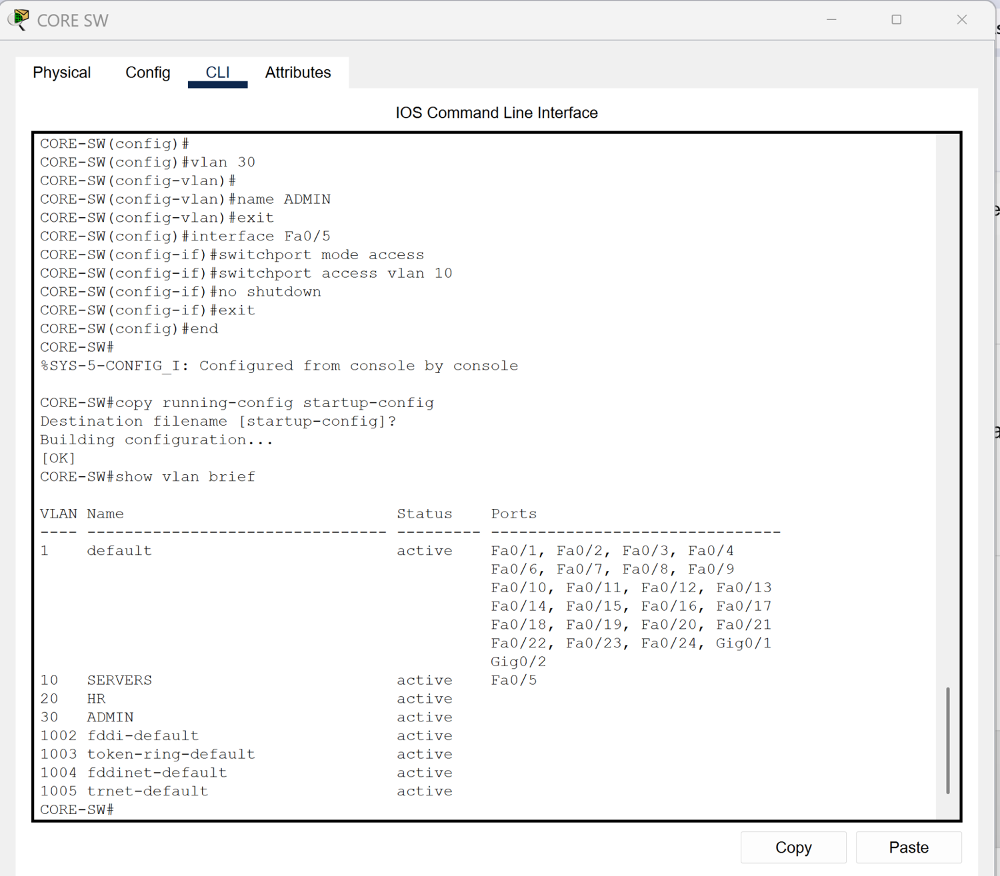
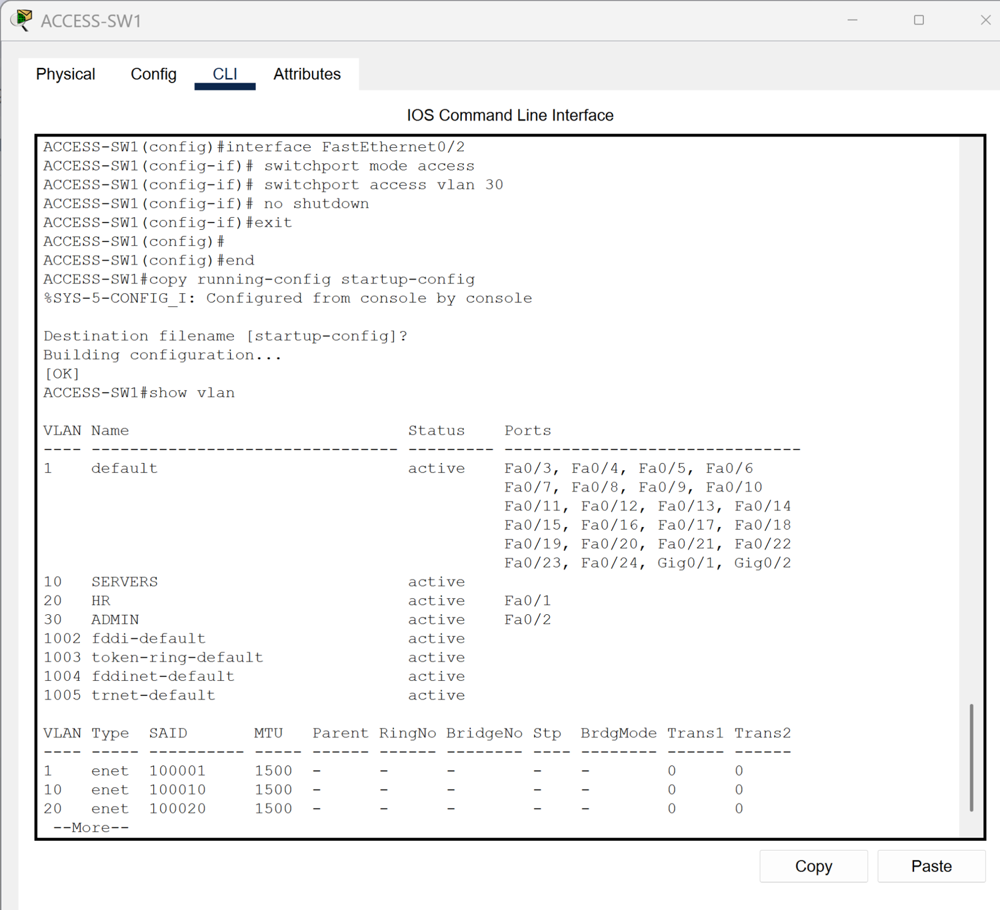

# VLANs and 802.1Q Trunking

[Campus LAN lab index](../../README.md)

## Objective

Segment the campus LAN into Servers, HR, and Admin broadcast domains. Configure endpoint-facing ports as access ports and carry the campus VLANs across the switch uplinks.

## Verification

| VLAN | Name | Subnet |
| --- | --- | --- |
| 10 | SERVERS | 192.168.10.0/24 |
| 20 | HR | 192.168.20.0/24 |
| 30 | ADMIN | 192.168.30.0/24 |

`show vlan brief` on CORE-SW lists all three VLANs and shows the server-facing Fa0/5 in VLAN 10. The access-switch capture shows the endpoint VLAN assignments. The [EtherChannel lab](../02-etherchannel/README.md) shows operational trunks carrying VLANs 10, 20, and 30.

*CORE-SW VLAN membership.*

*ACCESS-SW1 VLAN membership.*
