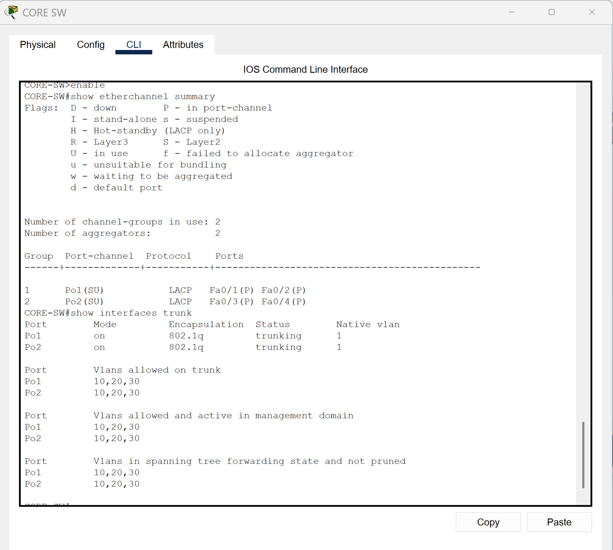

# LACP EtherChannel

[Campus LAN lab index](../../README.md)

## Objective

Bundle pairs of physical links into logical Layer 2 uplinks between the core and access switches.

## Verification

| CORE-SW bundle | Protocol | Bundled interfaces |
| --- | --- | --- |
| Po1 | LACP | Fa0/1, Fa0/2 |
| Po2 | LACP | Fa0/3, Fa0/4 |

`show etherchannel summary` reports both channels as Layer 2 and in use (`SU`), with each member bundled (`P`). `show interfaces trunk` shows both port-channels trunking with 802.1Q and forwarding VLANs 10, 20, and 30.

*LACP member status and operational port-channel trunks.*
