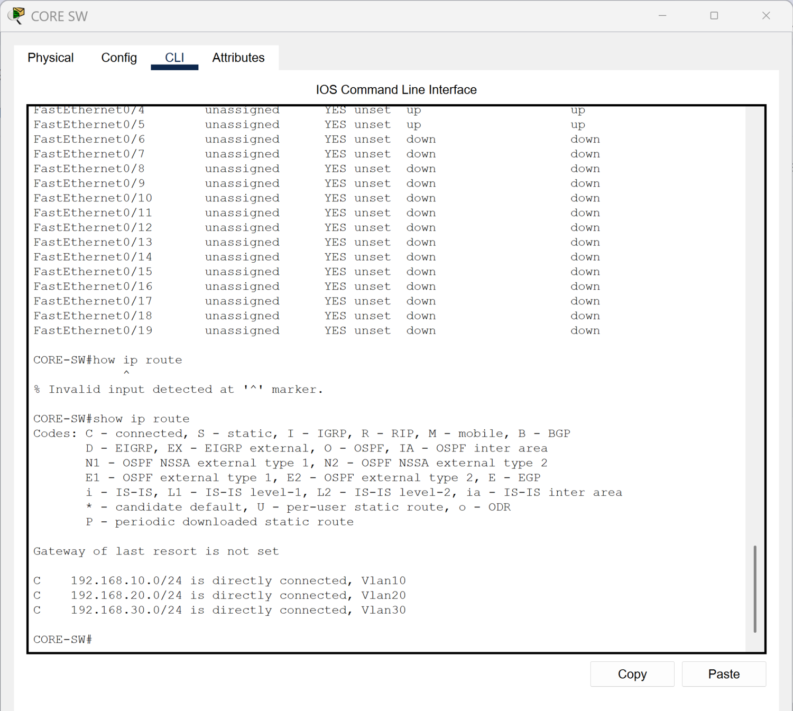

# Inter-VLAN Routing

[Campus LAN lab index](../../README.md)

## Objective

Use CORE-SW as the Layer 3 gateway for the campus VLANs through switched virtual interfaces (SVIs).

## Verification

| SVI | Default gateway | Connected network |
| --- | --- | --- |
| VLAN 10 | 192.168.10.1 | 192.168.10.0/24 |
| VLAN 20 | 192.168.20.1 | 192.168.20.0/24 |
| VLAN 30 | 192.168.30.1 | 192.168.30.0/24 |

`show ip route` lists the three directly connected networks. The [DHCP lab's client capture](../04-dhcp/screenshots/gateway-and-server-pings.png) shows successful pings from the Admin PC to its gateway and the server in VLAN 10.

*CORE-SW routing table with all three campus subnets.*
