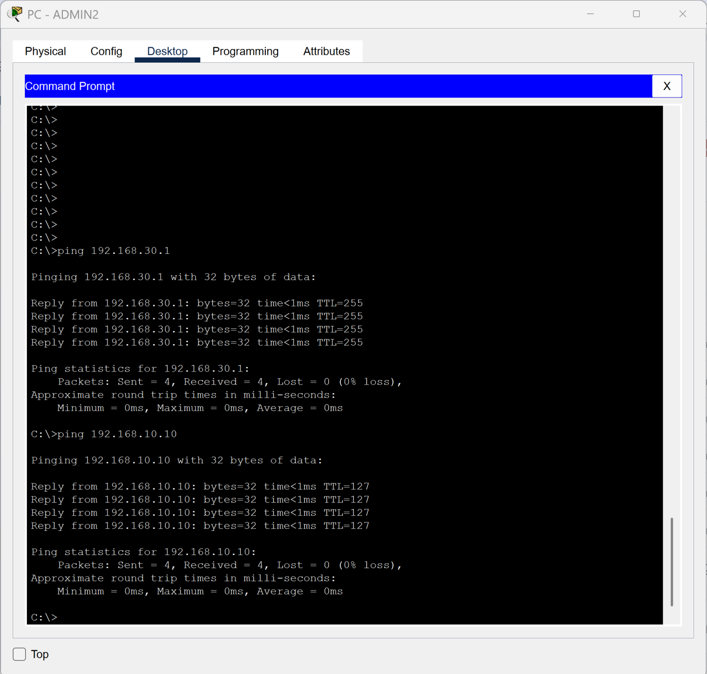

# Centralized DHCP

[Campus LAN lab index](../../README.md)

## Objective

Provide client addressing from a central Packet Tracer DHCP server on the Servers VLAN. Clients on other VLANs use DHCP relay on their gateway interfaces to reach the server.

## Verification

The topology places the DHCP server in VLAN 10. The client capture shows four successful replies from the VLAN 30 gateway (`192.168.30.1`) and four from the server (`192.168.10.10`).

To verify DHCP assignment directly, capture the client IP configuration in DHCP mode and the corresponding server pool or gateway relay setting. The ping capture verifies reachability.

*Admin client reaches its gateway and the DHCP server with zero packet loss.*
