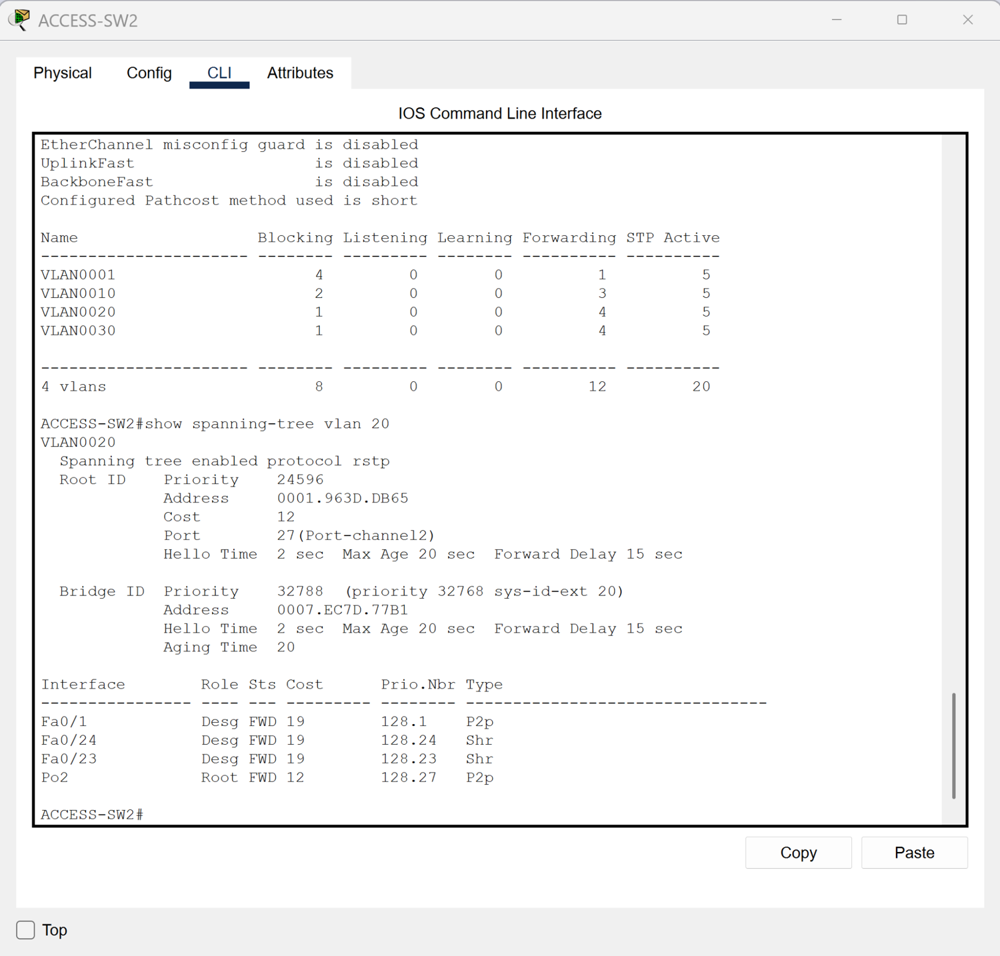

# Rapid Spanning Tree

[Campus LAN lab index](../../README.md)

## Objective

Inspect how spanning tree selects the upstream path and keeps the Layer 2 topology loop-free.

## Verification

`show spanning-tree vlan 20` on ACCESS-SW2 reports RSTP and identifies Port-channel2 as the root port in forwarding state. Fa0/23 and Fa0/24 are designated forwarding ports in the captured VLAN 20 view.

This capture verifies port roles and states for VLAN 20. A separate capture would be needed to document an alternate port or reconvergence after a link failure.

*ACCESS-SW2 VLAN 20 spanning-tree root port and forwarding states.*
