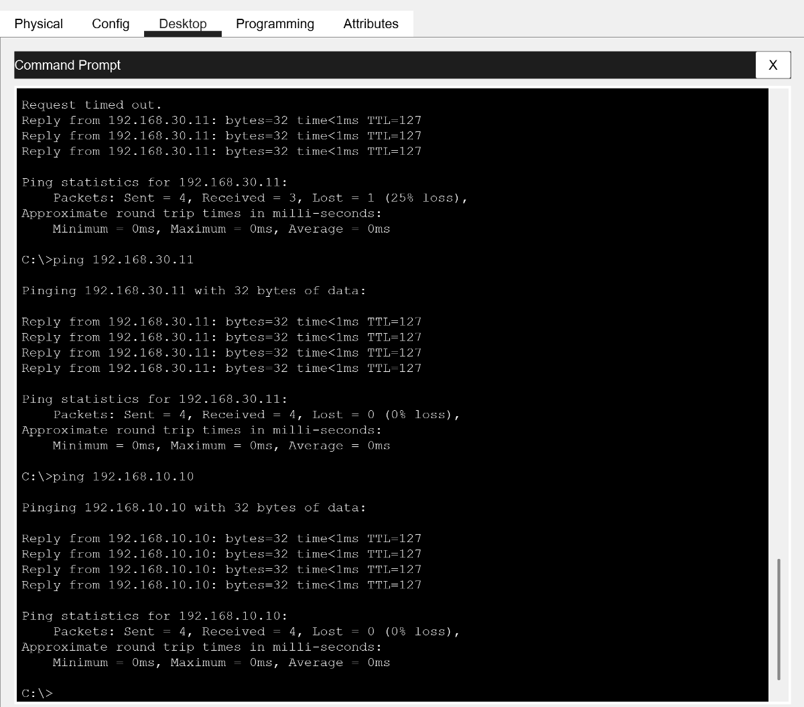
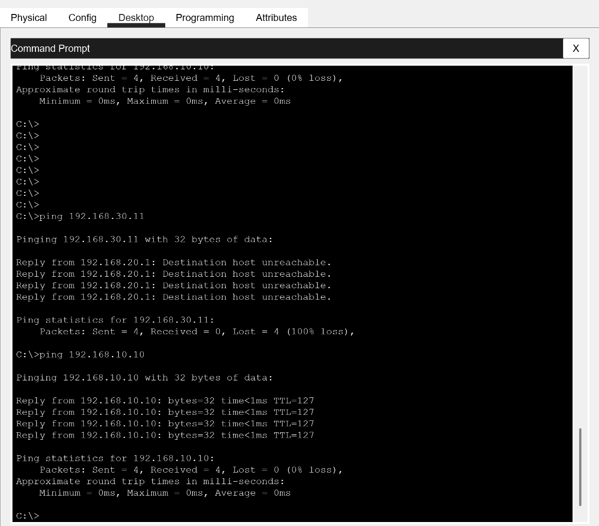

# Lab 06 — Inter-VLAN Filtering with an Extended ACL

[Campus LAN lab index](../../README.md)

## Objective

Block routed IPv4 traffic from VLAN 20 (HR, `192.168.20.0/24`) to VLAN 30 (ADMIN, `192.168.30.0/24`) while preserving HR access to the server in VLAN 10.

## Configuration

On `CORE-SW`, apply the named extended ACL inbound on the VLAN 20 switched virtual interface. The first rule matches traffic from HR to ADMIN. The second permits remaining IPv4 traffic.

```text
configure terminal
ip access-list extended HR-TO-ADMIN
 deny ip 192.168.20.0 0.0.0.255 192.168.30.0 0.0.0.255
 permit ip any any
exit
interface vlan 20
 ip access-group HR-TO-ADMIN in
end
```

## Verification

The same two pings were run from PC-HR1 before and after applying the ACL.

| Destination | Before ACL | After ACL |
| --- | --- | --- |
| PC-ADMIN1 (`192.168.30.11`) | 4 of 4 replies on retry | 0 of 4 echo replies |
| VLAN 10 server (`192.168.10.10`) | 4 of 4 replies | 4 of 4 replies |

**Before.** Both destinations responded to all four requests in the final baseline tests.



**After.** The VLAN 20 gateway (`192.168.20.1`) returned destination-unreachable messages for the ADMIN test. The server continued to respond.


